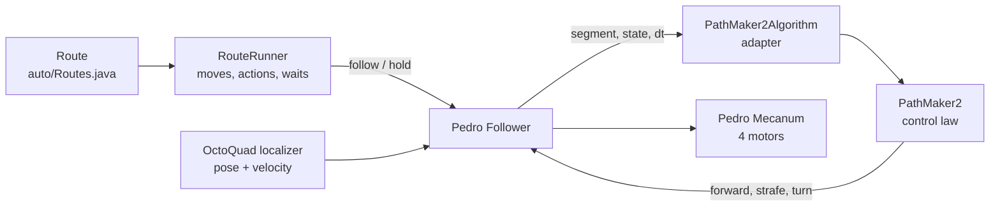

# PathMaker 2

**A measured, point-to-point drive controller for FTC robots**

White paper, November 2026. PathMaker-Coach repository (SergiosGit/Pathmaker-Coach).

> **Status.** The control law has run on the coach's bay-b bot in single benchmark runs against
> Pedro Pathing 3 and PathMaker 1 (`docs/bench/data/2026-11-06*`). The last change
> (`brakeMinSpeed`) has only been tested in simulation. The competition version for team
> 3rd Gear (branch `pm_upgrade` of bayrobotics/3rd-Gear-26-27) compiles and runs in simulation,
> but has not yet driven the season robot. The 10-run benchmark blocks are still to do.

## Summary

PathMaker 2 drives a mecanum robot from one point to the next as fast as it can while still
being able to stop on the spot. It needs no hand tuning. Every number it uses is either
measured by our calibration page or a fixed, physically meaningful setting, such as "use 75 %
of the measured braking".

PathMaker 2 sits between two systems we know well:

- **PathMaker 1**, the student-written controller it replaces, which drove x, y and heading as
  three separate ramps with hand-tuned powers.
- **Pedro Pathing 3**, the community path follower, which follows curved paths using a model
  with about seventeen tuned values.

PathMaker 2 keeps PathMaker 1's simplicity (no paths, just targets) and borrows Pedro's main
idea: brake from a measured stopping distance, instead of from guessed ramps.

It runs as an *algorithm* inside Pedro's `Follower`. Both controllers therefore share the same
OctoQuad localizer, motor output and loop, and only the control law differs. The core,
`pathmaker2/PathMaker2.java`, is about 230 lines of plain Java with no hardware or Pedro
classes. The same file runs on the robot and in the laptop simulator.

On the bay-b bot, measured by when the robot has actually stopped within 1 inch of the target,
PathMaker 2 settled as fast as or faster than Pedro on four of the six benchmark tests.
Pedro was better at turning in place and on the curve. These are single runs, so they are a
first look, not a result.

---

## 1. What PathMaker 2 is

PathMaker 2 is a **point-to-point controller**. A route is a list of target poses (x, y,
heading), and the robot drives straight from one to the next. It does not follow a drawn
curve. A curve is approximated by passing through points along it.

Three design rules shaped it:

1. **Measure, don't tune.** The robot's physics is measured once on the calibration page:
   - top speed;
   - braking deceleration;
   - the start-up power, kS, which is the power needed to overcome friction.

   The control law uses these numbers directly. There are no PID gains to search for.
2. **Small enough to understand.** A student should be able to read the whole control law in
   one sitting, and a coach should be able to change it in an afternoon.
3. **Same plumbing as Pedro.** Localization, motor output and the loop are Pedro's. That makes
   a fair comparison possible, and it means improvements to Pedro's localizer reach us for free.

## 2. The user interface

### 2.1 Routes

Students write routes, not controllers. A route is a list of steps in `auto/Routes.java`,
read top to bottom:

```java
public static Route close() {
    FieldPose s = CLOSE_START;                 // measured on the field
    return Route.start(s)
            .speed(0.5)                        // first tests at half speed
            .shooter(ShooterConfig.autoTargetRpm)
            .to(s.x - 4, s.y - 11, 90)         // drive here and stop
            .waitForShooter(2)
            .feed(5)                           // shoot for 5 s
            .shooter(0)
            .turnTo(175)
            .to(s.x - 44, s.y + 14, 175)       // turns while it drives
            .build();
}
```

| Step | Meaning |
|---|---|
| `to(x, y, h)` | Drive straight there and stop; the heading changes smoothly on the way |
| `through(x, y, h)` | Drive towards it without stopping; the next move starts within 3 in |
| `turnTo(h)` | Turn in place |
| `speed(f)`, `timeout(s)` | Fraction of top speed for the following moves; time limit for the next move |
| `shooter(rpm)`, `intake(p)`, `servo(x)` | Mechanism settings, applied the moment the step is reached, even between two `through` points |
| `waitForShooter(s)`, `feed(s)`, `pause(s)` | Waits; the robot holds its position |

A move ends when the robot has **stopped** within ½ inch and 1°, or when its timeout
(4 s by default) runs out.

The old PathMaker had three things to tune in every step: the powers, the ramp distances and
the per-axis delays. In the new routes they are gone.

The full guide for students is `docs/PATHMAKER2-PATHS.md`.

### 2.2 Coordinates and alliances

Routes use Pedro's field coordinates:

- 0 to 144 inches on each axis;
- heading measured counter-clockwise from +x, so 90° faces up the field.

Routes are written once, for the blue alliance. The red route is generated with one of two
field symmetries, chosen by a single line in `Routes.java`:

| `FieldSymmetry` | x | y | heading |
|---|---|---|---|
| `MIRROR` (red is blue in a mirror) | 144 − x | y | 180° − h |
| `ROTATE` (red is blue turned half way round) | 144 − x | 144 − y | h + 180° |

Each start position and colour is a three-line OpMode, for example `AutoCloseBlue`, so the
drive team still picks the autonomous from the Driver Station list. This replaces a
copy-pasted `switch` with about 30 near-identical blocks per alliance. In that code, the red
and blue close routes had ended up identical, so one of them drove the wrong way.

### 2.3 Calibration page

The robot measures itself. Run the **Calibrate** OpMode and open http://192.168.43.1:8090.
One page runs every step:

1. motor directions;
2. odometry ports and directions;
3. OctoQuad heading and pod offsets;
4. Pedro's Foresight values;
5. **PathMaker drive**:
   - speed noise while standing still;
   - kS forward, sideways and turning;
   - braking deceleration with the motors braking;
   - top turning speed.

Results are saved on the Control Hub the moment a step finishes, so closing the browser loses
nothing. Each value is shown with its source (default, committed or measured). "Export Java"
writes them into `RobotCalibration.java` for git. See `docs/CALIBRATION.md`.

### 2.4 Live settings and telemetry

The choices that are not measurements are `@Configurable`, so they appear in the Panels
Configurables view and can be changed while the robot runs. They include the braking margin,
the speed-up limit, the final-approach gain and the tolerances. During a route the telemetry
shows:

- the step number and the step;
- the pose;
- the distance and heading still to go;
- the shooter speed.

---

## 3. Under the hood

### 3.1 Where it sits



Each loop the Follower reads the localizer and asks the algorithm for robot-relative powers:
forward, strafe (left positive) and turn (counter-clockwise positive). The `RouteRunner`
turns consecutive moves into one Pedro path of straight segments. PathMaker 2 uses only each
segment's **end point**, not its shape. When the last segment ends, the Follower holds the
end pose, and PathMaker 2 provides the hold as well.

### 3.2 Translation: one speed along one line

Each loop PathMaker 2 works out the vector from the robot to the target. That gives a
distance $d$ and a unit direction $\hat u$, which it turns into the robot's frame. Translation
is one problem, not two: the robot drives along $\hat u$, so x and y arrive together.

**Speed wanted.** The robot may go no faster than the lowest of three limits:

$$
v_\text{wanted} = \min\Big( s \cdot v_\text{max}(\hat u),\;\; \sqrt{2 \, m \, a_\text{brake}(\hat u) \, d},\;\; k_\text{app} \, d \Big)
$$

- $v_\text{max}$ is the measured top speed in that direction, blended between forward
  (62 in/s on the bay-b bot) and sideways (48 in/s). $s$ is the route's `speed(...)`.
- $\sqrt{2 m a d}$ is the speed from which the robot can still brake to a stop in the
  distance left. $a_\text{brake}$ is the **measured** braking deceleration (149 in/s² forward,
  159 sideways), and $m = 0.75$ is the margin.
- $k_\text{app} d$, with $k_\text{app} = 4\ \text{s}^{-1}$, is a gentle final approach. Near the
  target, braking alone would ask for an abrupt stop.

A pass-through point uses $s \cdot v_\text{max}$ only: the robot keeps its speed into the next
segment.

**Speed command.** The command may rise by at most 250 in/s² so the wheels don't slip, but
it falls at once.

**Power.** Feedforward plus a small correction on the measured speed:

$$
P = k_S\,\hat u \;+\; k_V\, v_\text{cmd}\,\hat u \;+\; k_v \,(v_\text{cmd}\hat u - \vec v), \qquad k_V = \frac{1-k_S}{v_\text{max}}
$$

$k_S$ is the measured start-up power (0.10 forward, 0.14 sideways), applied until the robot is
within tolerance. Without it, the robot used to stall just short of the target. $k_V$ follows
from $k_S$ and the top speed, and $k_v = 0.01$ power per in/s.

**Braking by cutting power.** This was the most important thing the robot logs taught us. With
any positive power, the bay-b bot only *coasts* down, at about 30 in/s². It decelerates at
149 in/s² only when the power is **zero** and the motors brake. Reducing the power gradually
therefore cannot follow the braking curve. The first version overshot by 3.2 in that way.

So when the robot is faster than the speed wanted, PathMaker 2 sets the power along the line to
zero and keeps only a small sideways correction that steers it back onto the line. Two details
keep it smooth:

- **A ±2 in/s dead band.** Braking starts when the robot is 2 in/s too fast and ends when it is
  2 in/s too slow. This stops the power switching on and off every loop.
- **No cutting below 20 in/s.** The final approach uses the normal power law, so the robot does
  not stutter in the last inches.

### 3.3 Heading: the same law, in degrees

Heading uses the same three limits:

- measured top turn speed (329°/s);
- $\sqrt{2 m \alpha |\Delta h|}$, with the measured turn braking of 1731°/s²;
- an approach gain.

It also uses the same kS, kV and feedback structure and a speed-up limit of 1200°/s². In a
`to(...)` move the target heading moves smoothly from the start heading to the end heading, in
proportion to the distance covered. The heading is therefore right when the robot arrives,
rather than first or last.

### 3.4 Combining

1. **Battery.** All three powers are multiplied by $V_\text{nominal}/V_\text{battery}$
   (12.5 V nominal, limited to 0.8–1.3). A drained battery still gets the power the
   calibration measured.
2. **Wheels.** A mecanum wheel's power is forward ± strafe ± turn. If
   $|f| + |s| + |t| > 1$, all three are scaled down together, so the direction of travel and
   the turn stay in proportion.

### 3.5 Ending a move, passing, holding

- **Stop point:** done when within 0.5 in **and** 1° **and** slower than 3× the measured
  standstill noise (at least 1 in/s and 3°/s). PathMaker 1 checked position only, and could end
  a step at full speed.
- **Pass-through point:** done within 3 in, or as soon as the robot is past it along the line
  from the previous point.
- **Timeout:** a move gives up after its timeout, so a blocked robot still finishes the route.
- **Hold:** the same law with the target fixed and "done" never reached. It keeps the robot on
  its spot during waits, and against pushes.

### 3.6 Where the numbers come from

| Value | Source | Bay-b bot |
|---|---|---|
| Top speed forward / sideways | calibration (Foresight step) | 62 / 48 in/s |
| Top turn speed | calibration (PathMaker step) | 329 °/s |
| Braking deceleration forward / sideways / turn | calibration (PathMaker step) | 149 / 159 in/s², 1731 °/s² |
| kS forward / sideways / turn | calibration (PathMaker step) | 0.10 / 0.14 / 0.10 |
| Standstill speed noise | calibration (PathMaker step) | 0.2 in/s, 0.5 °/s |
| Braking margin, dead band, min. cutting speed | setting | 0.75, 2 in/s, 20 in/s |
| Speed-up limit, approach gain, speed feedback | setting | 250 in/s², 4 s⁻¹, 0.01 |
| Tolerances | setting | 0.5 in, 1° |

The settings were chosen once from the robot logs and the simulator. They are meant to stay
fixed from robot to robot. Everything that differs between robots is measured.

---

## 4. What changed from PathMaker 1

PathMaker 1 was written for students and was easy to read. Its design review
(`docs/PATHING-PEDRO-VS-PATHMAKER.md`, section 2.1) listed eleven weaknesses:

| | PathMaker 1 | PathMaker 2 |
|---|---|---|
| W1 | Blocking 40 ms sleep: the whole robot ran at 25 Hz | No sleep; the loop runs as fast as the hardware allows (p95 under 12 ms on the bay-b bot) |
| W2 | x and y driven separately: diagonal first, then along the remaining axis | One 2D direction straight at the target; x and y arrive together |
| W3 | Pure P near the goal, no kS: the robot stalled short and steps ended on their timer | Measured kS until within tolerance |
| W4 | All-or-nothing "energy" braking, mass- and battery-dependent | Braking from the measured stopping distance, with a dead band |
| W5 | VELOCITY ramp mode divided by a constant 1.0 | Removed |
| W6 | Power shared by the sum of the axes | Scaled by the largest wheel |
| W7 | Step done without checking speed | Done only when stopped |
| W8 | 40 ms odometry without arc correction | OctoQuad localizer (on-board, IMU heading) |
| W9 | No battery compensation | $V_\text{nominal}/V$ scaling |
| W10 | All state in public statics | Objects with parameters; the core is pure Java and runs in a simulator |
| W11 | Paths copy-pasted per alliance | Routes as data, red generated from blue |

There is more beyond the table:

- Per-axis start delays and `pathTime_ms` rolling stops are gone. Students used them mainly to
  make a step wait or turn only, and that is now `pause`, `turnTo` and real pass-through points.
- Mechanism actions (shooter, intake, servo) are steps in the route, instead of values attached
  to each path.
- Every constant is measured, not guessed.

On the bay-b bot, PathMaker 1 (with W1, W3, W5 and W7 fixed so it could take part in the
benchmark) overshot a 48-inch straight move by 5.2 in at matched speed and 12.3 in at full
speed. It ran 4–7 in off the line on the diagonal and curved tests. After its braking fixes,
PathMaker 2 stopped the same move 0.3 in short, with no overshoot.

---

## 5. How it compares with Pedro Pathing

### 5.1 What Pedro does

Pedro Pathing 3's `Foresight` algorithm is a **path follower**. Each loop it does three things.

1. **Finds the closest point on the path.** It works out the path's tangent, normal and
   curvature there, and the distance left.
2. **Predicts the pose.** It projects the robot's whole pose, position *and* heading, forward
   by the distance it would need to brake. That is the "foresight". It then works out the
   errors at that projected pose.
3. **Computes and combines four contributions.**
   - drive along the tangent, with a speed limited by a braking model that has linear and
     quadratic coefficients;
   - translational correction back onto the path;
   - centripetal feedforward for curves;
   - heading correction.

   A **power allocator** shares the available wheel power between these contributions in a
   priority order. The order changes with whether the robot is off the path or off its heading.

Pedro's tuning procedure measures about seventeen values for this, including braking
coefficients, two gains per axis, coast and brake gains, and heading gains.

### 5.2 Three 1-D problems or one 3-D problem?

A short way to put the difference: PathMaker solves the path as three one-dimensional
problems, while Pedro treats it as one three-dimensional problem in x, y and φ.

That description is **exactly right for PathMaker 1**, which drove x, y and heading as three
independent ramps. For PathMaker 2 and for Pedro it needs refining:

- **PathMaker 2 solves two one-dimensional problems, not three.**
  - *Distance to go* along a line that is re-aimed at the target every loop.
  - *Heading to go.*

  x and y are deliberately **not** separated. Separating them was PathMaker 1's weakness W2,
  and the cause of its curved, off-line moves. The two problems are coupled only at the very
  end, when the wheel powers are scaled down together.
- **Pedro is not one simultaneous 3-D solve either.** It also splits the problem into parts:
  along the path, across the path and heading. But two things couple the parts:
  - It works them out at a pose predicted in all three of x, y and φ together.
  - It makes them compete for one power budget through the priority allocator.

So the useful distinction is **decoupled versus coupled**, rather than 1-D versus 3-D:

| | PathMaker 2 | Pedro Foresight |
|---|---|---|
| Sub-problems | distance to go, heading to go | along-path, cross-path, curvature, heading |
| Frame | straight line to the target, re-aimed each loop | the path's tangent and normal at the closest (and projected) point |
| Coupling | only the final wheel scaling | predicted 3-D pose plus a shared power budget with priorities |
| Each sub-problem's solution | closed form: $\sqrt{2ad}$, kS + kV·v | model plus tuned gains |
| Values to measure or tune | 9 measured + 2 top speeds | about 17 tuned |

Is the decoupled form **more robust**? In two specific senses, yes:

- **Each part can be checked on its own.** If a straight move overshoots, the cause is the
  braking value or the margin, and nothing else. In a coupled controller an overshoot can come
  from the braking model, the coast and brake gains, the allocator's priority switch, or how
  they interact. On the robot we found and fixed PathMaker 2's two braking problems, the power
  chatter and the final-approach stutter, from one log each.
- **Fewer values, all physical.** A wrong measurement shows up as a plain number on the
  calibration page ("braking 80 in/s²" on a robot that brakes at 150). It doesn't hide as a gain
  that happens to work on one battery.

In other senses, no. Coupling buys capability:

- Pedro follows a **curve** with the curvature feedforward, and keeps the robot on the line
  between the points. PathMaker 2 approximates a curve with pass-through points and steers
  straight at each one.
- Pedro's priorities let it **trade** drive speed for correction when the robot is pushed off
  the path. PathMaker 2 simply re-aims at the target, so after a push it takes the straight
  line from wherever it is rather than returning to the original line.
- On the bay-b bot Pedro was better at **turning in place** (A4) and on the **curve** (A6).

The fair claim is this: for the point-to-point routes FTC autonomous mostly needs, a decoupled
controller with measured constants is easier to get right and to keep right. For paths whose
shape matters, coupling is worth its complexity.

### 5.3 Robot results so far

Bay-b bot, 6 November 2026, single runs. The numbers are the time until the robot is within
1 in and 2° of the target and stays there ("settled"). That is a fairer clock than each
controller's own "done" flag: Pedro reports done while still moving and then holds, often
0.5–0.8 in away, and at 0.5 in it never settled on two tests.

| Test | Pedro | PathMaker 2 | PathMaker 1 |
|---|---|---|---|
| A1 48 in forward, matched speed | **1.71 s** | 1.91 | 2.82 |
| A1 48 in forward, full speed | 2.03 | **1.67–1.94** | 3.92 |
| A2 48 in strafe | 2.57 | **1.98** | 2.63 |
| A3 diagonal while turning | 2.73 | **2.49** | 3.14 |
| A4 turn 180° in place | **0.99** | 1.50 | 1.94 |
| A5 pass, pass, stop | 5.83 | **4.75** | 6.42 |
| A6 quarter circle | **2.12** | 2.28 | 3.45 |

Loop time was under about 12 ms at the 95th percentile for all three.

**Caveats:**
- These are single runs, from before the 20 in/s change.
- The benchmark plan calls for 10-run blocks in ABBA order, with a tape-measured end pose,
  before any conclusion.

### 5.4 We own the code

PathMaker 2 is ours. That matters less as a licence question (Pedro is BSD-3, so we could fork
it too) than for **understanding and speed of change**. The control law is 230 lines that the
coach wrote and the students can read. Pedro's core library is about 6,500 lines, released on
its own schedule.

Two examples of what that has already meant:

- **Battery robustness.** PathMaker 2 scales its powers by battery voltage. In Pedro 3.0.2 the
  mecanum drivetrain has no voltage compensation; only its swerve drivetrain has one. On a
  drained battery a Pedro robot therefore gets less power than its tuning assumed, and relies
  on its feedback gains to make up the difference. We added compensation as one line. A Pedro
  user would wait for a release, or maintain a fork.
- **Fixing what the robot shows.** The logs showed that the bay-b bot brakes about five times
  harder at zero power than with any positive power. Within a day PathMaker 2 got three changes,
  each of them a few lines:
  1. braking by cutting power;
  2. a dead band against chatter;
  3. no cutting below 20 in/s.

  The calibration page also measures the values PathMaker needs, because we could add a step
  to it.

Owning the code also means owning its bugs. There is no community testing it on hundreds of
robots, and every improvement is our work. The arrangement we have is a good middle ground:
**Pedro's localizer, motor output and loop, with our control law plugged in.** We get the
community-tested plumbing and keep the part that decides how the robot drives.

### 5.5 Which to use when

| Need | Better choice |
|---|---|
| Point-to-point autonomous, students write and change routes | PathMaker 2 |
| A robot that must work after one calibration session | PathMaker 2 (nothing to tune by hand) |
| Curved paths whose shape matters, e.g. around field elements | Pedro |
| Fast turn-in-place | Pedro today (PathMaker 2's turn gains are a candidate for improvement) |
| A controller the team can read, explain and change before an event | PathMaker 2 |

Because both run in the same Follower, a team does not have to choose once and for all. A
route could use Pedro for one curved segment and PathMaker 2 for the rest. That is a possible
next step.

---

## 6. Limitations and next steps

- **Robot validation:**
  - The 20 in/s change still needs a robot run.
  - Then the 10-run ABBA benchmark blocks, with tape-measured end poses.
  - The season robot (`pm_upgrade`) has not driven yet.
- **Uncalibrated robots:** with the default kS (0.08) below a robot's real kS, turns stop
  1–3° short and end on the timeout. The autonomous warns "NOT CALIBRATED" during INIT.
  Calibrating fixes it. A small integral term on the final approach would make the defaults
  safer too.
- **Curves:** approximated by pass-through points. Real curve following would mean using the
  Pedro path's tangent, which the adapter already receives but ignores.
- **Turn in place:** about 0.5 s slower than Pedro on the bay-b bot; the turn approach gain and
  margin are the first things to look at.
- **Pushes:** after a push PathMaker 2 heads straight for the target from where it is, rather
  than returning to the original line.

## 7. Where to find things

| What | Where |
|---|---|
| Control law | `FtcRobotController/TeamCode/.../pathmaker2/PathMaker2.java` |
| Pedro adapter (bench) | `.../bench/PathMaker2Algorithm.java`, `PathMakerAlgorithm.java` |
| Calibration page | `.../calibration/`, `docs/CALIBRATION.md` |
| Benchmark plan, tools, data | `docs/PATHING-BENCHMARK-PLAN.md`, `.../bench/`, `docs/bench/` |
| Design review of PathMaker 1 and Pedro | `docs/PATHING-PEDRO-VS-PATHMAKER.md` |
| Student guide to routes | `docs/PATHMAKER2-PATHS.md` |
| Competition version | bayrobotics/3rd-Gear-26-27, branch `pm_upgrade` (`auto/`, `hw/Robot.java`, `pathmaker2/`) |
