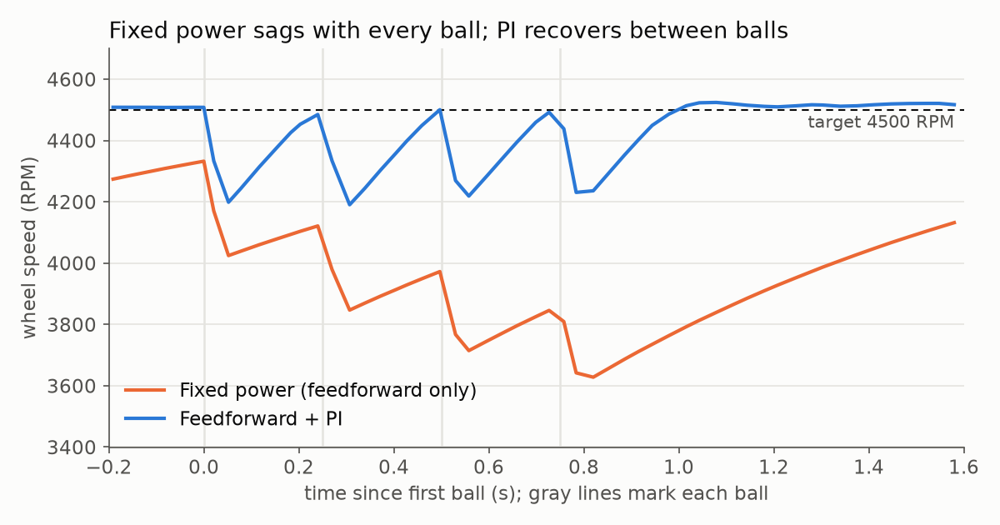
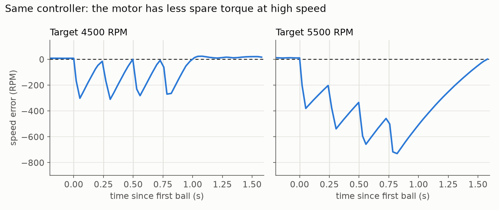

# Holding the shooter speed: a guide to our flywheel PID

**For:** the student working on the shooter, and the coach working through it with them.
**Goal:** shoot up to four balls in quick succession, each leaving the wheel at the same speed.

## The short version

- The current code does not control wheel speed at all. It sets a fixed motor power, and the variable called `targetRpm` is really that power (0.95 means 95%).
- The new code measures the real speed with a **REV Through Bore Encoder** read by the OctoQuad, and holds it using **feedforward plus PID**.
- In simulation, fixed power is about 570 RPM slow by the fourth ball of a burst. Each ball still dips the wheel by about 320 RPM with the new controller, but at 4500 RPM the wheel is back within about 20 RPM (under 0.5%) when the next ball arrives, as long as balls are at least 250 ms apart.
- **PID cannot create torque the motor doesn't have.** At 5500 RPM the wheel can't recover between fast shots, whatever the gains, and a better encoder doesn't change that. Rapid fire needs a target of about 5000 RPM or lower, or a mechanical change.
- Autonomous had a bug that kept the shooter off. That is fixed, but the autonomous paths now need a feed power added (see [Open items](#open-items)).
- The Through Bore needs a mounting plan, because its inserts don't fit the motor's 8 mm REX shaft (see [Section 8](#8-hardware-setup)).

Nothing has run on the real robot yet. The simulation uses data-sheet motor numbers and some estimates, so treat its results as a guide until Panels shows real ones.

---

## 1. What we found in the code

### Problems that affect shooting

| # | Where | What is wrong | Status |
|---|---|---|---|
| 1 | `ExtraStuff.targetRpm`, `PathDetails.targetRpm` | The name says RPM, but the value is a motor power. Nothing holds a speed, so shots change as the battery drains. | Fixed: it is now real RPM |
| 2 | `PathMakerStateMachine`, the call to `Extra_Stuff` | The first two arguments are swapped. In autonomous the intake gets 0.95 and the **shooter gets 0**. | Fixed, see [Open items](#open-items) |
| 3 | `TeleOpMode` telemetry | "outtakeMotor RPM" actually reads `backLeft`, and in encoder ticks per second rather than RPM. | Replaced |
| 4 | `ExtraStuff`, button A | Reverse stays on after one press, and no button turns the shooter off. | Now hold A to reverse, right bumper for off |
| 5 | `RobotPose.readPose` | Reads all four motor currents on every loop. Nothing uses them, and these are slow reads that aren't part of the bulk read. | Turned off |

Problem 1 also shows up as the presets 0.90, 0.95 and 1.00. At 1.00 the motor is already flat out, so there is nothing left to speed the wheel back up after a ball.

### A question for the coach: why was the built-in PID unreliable?

The current code runs the shooter with `RUN_WITHOUT_ENCODER`, so the built-in PID isn't active in this copy. That means this copy can't show why it failed. Problem 3 does suggest one thing to check, though.

**Check where the shooter's encoder cable was plugged in.** Telemetry reads shooter speed from the `back_left` port, and odometry uses the other three drive ports. That would make sense if the shooter encoder was plugged into `back_left`'s port. The hub's built-in PID only reads the encoder on the motor's own port, so it would have been controlling with no real speed signal. This is a guess from the code, not something we have confirmed.

### Things to clean up later

These don't affect the shooter, so we left them alone. They make good practice:

- `RobotConfig.Camera.customCameraCalibration()` calls itself forever and would crash if it were ever used.
- The five `AutoOp_*` files are almost identical, so every fix has to be made five times.
- Those files also create `ExtraStuff` as a field while the motors are still `null`, then again inside `runOpMode`. The first one does nothing useful.

---

## 2. The physics: why the wheel slows down

Think of the flywheel as a battery for motion. The motor charges it slowly over about a second, and a ball drains it in about 40 ms.

The motor alone could never supply a ball's energy that quickly, which is why we have a heavy steel flywheel. Our estimate is that **each ball takes about 7% of the wheel's speed**, or roughly 320 RPM at 4500 RPM.

That leaves the motor a short time to refill the wheel before the next ball. How fast it can do that depends on speed, because a spinning motor also acts as a generator. The generated voltage pushes back against the battery, so the faster the motor spins, the less current and torque it can produce. At its 6000 RPM free speed it has essentially no spare torque.

| Target speed | Dip from one ball | Time to get back within 100 RPM |
|---:|---:|---:|
| 3000 RPM | 211 RPM | 100 ms |
| 4000 RPM | 281 RPM | 131 ms |
| 4500 RPM | 316 RPM | 168 ms |
| 5000 RPM | 353 RPM | 231 ms |
| 5500 RPM | 392 RPM | 365 ms |

*Simulation, assuming a 35 g ball. Weigh a real ball: at 50 g, a 250 ms burst at 4500 RPM falls about 120 RPM short instead of staying within about 10.*

**The lesson:** look at the last row. No software can make that faster, because the motor is already at full power for the whole recovery. Knowing whether a limit comes from the code or from the hardware saves a lot of wasted tuning.

---

## 3. The sensor: the Through Bore Encoder and the OctoQuad

We measure speed with a [REV Through Bore Encoder V2](https://www.revrobotics.com/rev-11-3174/) (REV-11-3174). The OctoQuad counts how many encoder counts arrive in a fixed time window, and we convert that to RPM:

```
RPM = (counts / 8192) x (60000 / window_ms)
```

| | Motor's built-in encoder | Through Bore Encoder |
|---|---:|---:|
| Counts per revolution | 28 | 8192 |
| One count at a 40 ms window | 54 RPM | 0.18 RPM |
| One count at a 20 ms window | 107 RPM | 0.37 RPM |
| Maximum speed | Not a concern | 10,000 RPM |

### What it improves, and what it doesn't

Simulated at 4500 RPM with balls 250 ms apart:

| Setup | Speed error while holding | Power jitter | Error as each ball arrives (RPM) |
|---|---:|---:|---|
| Motor encoder, 40 ms window | 28 RPM | 0.060 | +18, −20, −16, −17 |
| **Through Bore, 20 ms window** | **9 RPM** | **0.003** | **+8, −8, +4, +4** |

The Through Bore holds speed about three times more tightly and gives the motor a far steadier command. It also shows you the real shape of each dip, and it reads the wheel directly.

**It doesn't make the wheel recover faster.** Recovery is limited by motor torque, so the 5500 RPM results in [Section 5](#5-what-the-simulation-shows) are almost unchanged.

### The trap: the 16-bit register

The OctoQuad stores counts-per-window in a signed 16-bit number, which can't go above 32,767. Past that it wraps around to a wrong value, like a car odometer rolling over. The motor encoder could never get close, but the Through Bore can:

| Window | One count equals | Counts at 4500 RPM | Wraps above |
|---:|---:|---:|---:|
| 10 ms | 0.73 RPM | 6,144 | 24,000 RPM |
| **20 ms (our choice)** | **0.37 RPM** | **12,288** | **12,000 RPM** |
| 30 ms | 0.24 RPM | 18,432 | 8,000 RPM |
| 40 ms | 0.18 RPM | 24,576 | **6,000 RPM** |
| 50 ms | 0.15 RPM | 30,720 | **4,800 RPM** |

A 40 ms window would wrap right at the motor's rated free speed, and a fresh battery can push the motor past that. In simulation with a 13.5 V battery and a 6400 RPM target, the speed reading became useless. `Shooter` therefore limits the window to the longest safe value, currently 31 ms, however it is set in Panels. `velocity_window_ms` in the tuning OpMode shows the value in use.

### Why 20 ms?

There is now plenty of resolution, so a shorter window gives fresher readings. Too short brings a different problem: the encoder is accurate to ±0.5°, and that error matters more when the wheel turns less during the window. In simulation at 4500 RPM:

| Window | Speed error while holding | Power jitter |
|---:|---:|---:|
| 5 ms | 27 RPM | 0.065 |
| 10 ms | 11 RPM | 0.024 |
| 15 ms | 10 RPM | 0.010 |
| **20 ms** | **9 RPM** | **0.003** |
| 30 ms | 10 RPM | 0.008 |

Longer windows stop helping past about 20 ms, and the reading is also getting older. Treat small differences here as noise, because each row is one simulated run.

**Why use the OctoQuad's velocity reading?** Our loop time varies. If we worked out speed ourselves as "change in counts divided by loop time", any timing error would look like a speed change. The OctoQuad times its window with its own clock, so the reading doesn't depend on our loop. It is also rated for 1 million steps per second. The Through Bore produces about 819,000 at 6000 RPM, so it fits, and the limit would only be reached at about 7300 RPM.

---

## 4. The controller, in plain language

Think of cruise control in a car. It starts with a good guess at how far to press the pedal, then adjusts for what it sees. Our controller adds up these parts, each measured in motor power:

| Term | Formula | What it does | Car version |
|---|---|---|---|
| **Feedforward** | `kS + kV × target` | Calculated power for this speed, used before any error appears | "60 mph usually takes this much pedal" |
| **P**roportional | `kP × error` | The further off we are, the harder it pushes | "I'm 5 mph slow, press harder" |
| **I**ntegral | sum of `kI × error × time` | Slowly removes a small error that won't go away | "Still 1 mph slow, ease the pedal down" |
| **D**erivative | `−kD × change in speed` | Resists fast changes | "Slowing quickly, react now" |

Here, `error = target − measured`.

Feedforward does most of the work. At 4500 RPM it supplies about 0.78 of the power, and PI only handles the rest. That is why spin-up and recovery work without very large gains.

### Starting gains

| Gain | Start | Meaning |
|---|---|---|
| `kV` | 1/6000 ≈ 0.000167 | 12 V gives about 6000 RPM with no load |
| `kS` | 0.03 | Power needed to overcome friction |
| `kP` | 0.002 | A 100 RPM error adds 0.2 power |
| `kI` | 0.0006 | A 100 RPM error adds 0.06 power per second |
| `kD` | 0 | Off, explained below |

### Details that make it work on a robot

- **Anti-windup.** During a dip the motor is already at full power. If the integral kept growing, the wheel would overshoot and the next ball would fly long. So it only integrates near the target (`iZoneRpm`), and never while the output is at its limit.
- **Battery compensation.** Power is a fraction of battery voltage, so 0.78 gives a tired battery less push. We scale the output by `12 / batteryVolts`.
- **Power never goes negative.** To slow down we cut power and let the wheel coast. Pushing backward on a spinning flywheel causes large current spikes.
- **Why `kD` is 0.** The heavy wheel doesn't need damping. With the Through Bore, the derivative no longer goes wild from coarse steps as it would with the motor encoder, but in simulation it still added power jitter without improving the shots. The term is included so you can try it and see this for yourself.

### Safety behavior

| If this happens | The code does this |
|---|---|
| OctoQuad missing, cable out, or encoder backward | Reports `SHOOTER FAULT` and runs on feedforward only, rather than pushing full power at a wheel it can't see |
| A reading faster than the motor can spin | Ignores it, because single I2C reads have no error check |
| A velocity window long enough to overflow the register | Uses the longest safe window instead |
| Reverse requested while the wheel is above 500 RPM | Waits until the wheel slows down |

---

## 5. What the simulation shows

`docs/shooter_sim/ShooterSim.java` runs the **real controller code** against a physics model of the motor, flywheel, Through Bore Encoder, OctoQuad and a 20–40 ms loop.



*Fixed power was also still spinning up when the burst began, because without P it takes over 5 seconds to get close to the target. The new controller takes about 1.35 s.*

**More `kP` is not better.** At 4500 RPM with balls 300 ms apart:

| Controller | Error as each ball arrives (RPM) | Power jitter |
|---|---|---:|
| Fixed power | −167, −351, −480, −571 | 0 |
| P only, no feedforward | −1143, −1232, −1258, −1265 | 0.001 |
| **Feedforward + PI, `kP` 0.002** | **+8, +13, +20, +13** | **0.003** |
| Feedforward + PI, `kP` 0.004 | +2, +35, +35, +22 | 0.026 |
| Feedforward + PI, `kP` 0.012 | +9, +77, +45, +30 | 0.057 |

Raising `kP` above 0.002 makes the motor command many times noisier and the shots no better. Once a dip drives the motor to full power, extra gain can't add anything.

**Speed and spacing decide what is possible.** Error as each ball arrives, in RPM:

| Target | 150 ms apart | 250 ms apart | 350 ms apart | 500 ms apart |
|---|---|---|---|---|
| 3500 | +7, −14, −3, −43 | +7, +17, +14, +35 | +7, +9, +13, +16 | +7, +10, +12, +13 |
| 4500 | +8, −129, −187, −234 | +8, −8, +4, +4 | +8, +16, +18, +14 | +8, +8, +9, +4 |
| 5000 | +8, −203, −344, −458 | +8, −77, −113, −140 | +8, +9, +7, +14 | +8, +12, +10, +13 |
| 5500 | +11, −283, −506, −686 | +11, −193, −331, −432 | +11, −111, −182, −229 | +11, −2, −7, −15 |



Differences of 10–20 RPM are within the noise of the simulation, so don't read much into them.

---

## 6. Our strategy for four quick shots

1. **Choose the lowest speed that scores.** This is the biggest decision: it gives the motor more spare torque and shortens recovery.
2. **Space the balls about 250–350 ms apart.** At 4500 RPM, that is a four-ball burst in about 0.75–1.05 s. At 5000 RPM, use about 350 ms. Spacing comes from how the feed mechanism and intake power deliver the balls, so measure it.
3. **Don't feed until the wheel is ready.** `shooter.isAtSpeed()` turns true after the wheel has stayed within tolerance for 60 ms. In TeleOp, gamepad 2 rumbles when that happens.
4. **Optionally, let the code wait for the wheel.** With `gateIntakeOnSpeed = true`, the intake pauses until the wheel recovers. In simulation this gives consistent shots (within about 60 RPM) even at 5500 RPM, at the cost of a slower burst of about 1.4 s. It is off by default because we haven't confirmed it suits the real feed mechanism.

---

## 7. If we need more performance

If test shots show we really need about 5500 RPM, the fix is mechanical. Simulated with balls 250 ms apart:

| Option | Spin-up | Error as each ball arrives (RPM) | Trade-off |
|---|---|---|---|
| As built, 4500 RPM | 1.35 s | +8, −8, +4, +4 | |
| Second steel flywheel, 4500 RPM | 2.25 s | +11, −23, −28, −22 | Smaller dips but slower recovery and spin-up. Not an improvement at this spacing |
| **Second motor, 5500 RPM** | 1.11 s | +7, −21, −15, −11 | **Best option for high speed.** Uses another motor port. Compare with −193, −331, −432 for one motor |
| Second motor, 4500 RPM | 0.68 s | +8, +63, +26, +67 | Lower `kP` to about half: the same gain now acts through twice the torque |

---

## 8. Hardware setup

### Software requirement: FTC SDK version

OctoQuad boards running firmware v3 need an FTC SDK whose driver supports it. All MK2 boards run v3, and MK1 boards can be upgraded to it. SDK 10.3.0's driver supports firmware v2 only and uses a different register layout, while 11.2.1 supports v3. To see which firmware a board has, check the board label: MK1 shipped with v2, MK2 with v3.

### Wiring

1. **Plug the Through Bore into OctoQuad channel 0**, using the REV 6-pin to 4-pin cable included with the encoder (REV-31-1815). The stock cable is correct for quadrature; only absolute pulse-width signals need a modified one. Don't use the 6-pin to 6-pin cable or the PWM cable.
2. **Leave the motor's power cable on the hub**, on the `outtake_motor` port. The motor's own encoder is no longer used, so it can stay unplugged.
3. **Connect the OctoQuad to an I2C port on the hub.** Its I2C and encoder connections are **3.3 V only, not 5 V tolerant**. The encoder accepts 3.3–5 V, so powering it from the OctoQuad's connector is correct. Don't power it from a 5 V source.
4. **Add the OctoQuad to the robot configuration** as an I2C device named exactly `octoquad`.

### Mounting: the part that needs a plan

The encoder has to turn at exactly the same speed as the Rhino wheel, with no slip. If you end up gearing it, the RPM calculation has to change to match.

- **Shaft fit:** the encoder takes ½ in hex by default, and its inserts adapt it to ⅜ in hex, 5 mm hex or ¼ in round. **None of these is the motor's 8 mm REX shaft**, so it won't slide straight on. Options are a stretch of supported shaft (such as ½ in hex) that turns with the wheel, or a snug custom insert.
- **Fixing the body:** mount the encoder's body rigidly with its #10 holes so that it can't rotate. Any strain or wobble at up to 6000 RPM will wear the encoder and can appear as speed noise.
- **Check for magnetic interference:** it is a magnetic sensor, so mount it away from the motor if you can. If the speed graph looks noisy at steady speed, try moving it. We couldn't test this.

---

## 9. Tuning on the robot

Use the **Shooter Tuning** OpMode, which leaves the drive train alone. Keep hands and loose wires clear of the wheel.

**Open Panels:** connect a laptop to the Control Hub's WiFi and go to <http://192.168.43.1:8001>. Use the **Configurables** tab to find `ShooterConfig`, and the **Graph** tab to plot values.

**Graph these together:** `shooter_target_rpm` and `shooter_measured_rpm`. Use a second graph for `shooter_power`, `term_feedforward`, `term_p` and `term_i`, because their scale is very different.

Values changed in Panels are lost when the app restarts, so **copy good values into `ShooterConfig.java`**.

| Step | What to do | What to look for |
|---|---|---|
| **1. Check signs** | Press **Y** for fixed power 0.7 | The wheel spins the right way (otherwise flip `reverseMotor`). RPM is positive (otherwise flip `reverseEncoder`) |
| **2. Check the count** | With the wheel stopped, turn it by hand exactly one full turn and watch `encoder_counts`. Then press **Y** | The count changes by about 8192 per turn, and at power 0.7 the speed is roughly 3500–4300 RPM. A different count means the encoder isn't turning 1:1 with the wheel, or the wiring is wrong |
| **3. Set `kV`** | Try `tuningOpenLoopPower` at 0.5, 0.7 and 0.9. Wait for the speed to settle and read `kV_estimate_x1000` | Divide the average by 1000 and enter it as `kV` |
| **4. Set `kP`** | Press **A** to spin, then **X** to step the target down and up by 500 RPM | Raise `kP` until the response is quick, then back off if the speed rings or `shooter_power` looks like fuzz. Expect about 0.001–0.004 |
| **5. Set `kI`** | Watch `shooter_error_rpm` while holding speed | Any steady error should fade in a second or two. If the wheel overshoots or slowly swings, lower `kI` |
| **6. Shoot** | Hold the **left trigger** to feed four balls | Read `shooter_last_dip_rpm` and `shooter_last_recovery_ms`, and compare them with Section 2 |
| **7. Find speeds** | Test-shoot from each scoring position | Enter the RPMs as `presetLowRpm`, `presetMidRpm`, `presetHighRpm` and `autoTargetRpm`. The current values are placeholders |
| **8. Test the full robot** | Run TeleOp while driving | Check that `shooter_loop_ms` stays near 20–40 ms and the wheel behaves the same as on the bench |

The Graph updates about 13 times a second by default, so very short events can look blocky.

### New TeleOp controls (gamepad 2)

| Button | Action |
|---|---|
| X / Y / B | Low / mid / high preset speed (these were powers before) |
| Dpad up / down | Target ±100 RPM |
| Right bumper | **New:** shooter off, wheel coasts |
| A (hold) | **Changed:** reverse to clear a jam, and release to go back to the previous speed |
| Rumble | **New:** the wheel just reached speed |

### Experiments to try

1. **Predict first:** what happens to the graph with `kP` = 0.012? Try it, then explain the fuzz in `shooter_power`.
2. Set `velocityWindowMs` to 5, then 20. Which is noisier, and why? Then set it to 100 and check `velocity_window_ms` to see what the code actually uses.
3. Set `kV` and `kS` to 0 and tune with PID alone. Why is it so much harder?
4. Try a small `kD`, such as 0.00001, and watch `term_d`. Does it help, or does it mostly show noise?
5. Compare a fresh battery with a tired one. Does the shot change?

---

## 10. What changed in the code

**New files**

| File | Purpose |
|---|---|
| `hw/VelocityPidController.java` | The controller: plain Java with no robot hardware, so it can run on a laptop |
| `hw/Shooter.java` | Connects the Through Bore (through the OctoQuad), controller and motor, and adds safety checks, overflow protection and telemetry |
| `configuration/ShooterConfig.java` | Every tunable number, shown live in Panels |
| `op/ShooterTuning.java` | The bench tuning OpMode |
| `docs/shooter_sim/ShooterSim.java` | The simulation behind this document |

**Changed files**

| File | Change |
|---|---|
| `hw/ExtraStuff.java` | Uses `Shooter`, and presets are now RPM |
| `pathmaker/PathMakerStateMachine.java` | Fixes the swapped arguments, updates the shooter every loop, stops it when the path list is done |
| `pathmaker/PathDetails.java` | The 12 `targetRpm = 0.95` lines now use `ShooterConfig.autoTargetRpm` |
| `op/TeleOpMode.java`, all five `op/AutoOp_*.java` | Add `ExtraStuff.initShooter(hardwareMap)` and shooter telemetry |
| `op/RobotPose.java` | Stops the unused motor current reads |

All paths are under `TeamCode/src/main/java/org/firstinspires/ftc/teamcode/`, except the simulation.

**The one rule when writing new code:** call `shooter.update()` once per loop, every loop, and don't put long `sleep()` calls in a loop while the wheel is spinning. The motor only gets new commands inside `update()`.

---

## 11. How this was checked

| Check | Result |
|---|---|
| All TeamCode Java compiled against the real FTC SDK 11.2.1 and Panels libraries | Passed |
| `Shooter` run against a fake motor and OctoQuad: 24 checks, including dead, backward and missing encoders, and register overflow protection | All passed |
| Controller simulated across speeds, spacings, gains and battery levels | Results above |
| Full Android Studio / Gradle build | **Not done:** build it before deploying |
| Running on the robot | **Not done** |

Estimates in the simulation: ball mass (35 g), the Rhino wheel's inertia, the energy lost per shot, and the delay in sending motor commands. The motor figures, flywheel inertia, encoder resolution and encoder accuracy come from data sheets. The ±0.5° error is modeled as one smooth wave per turn; real error may look different, and shaft wobble isn't modeled. Each result is one simulated run.

Also unconfirmed: the Through Bore has never been run with the OctoQuad at these speeds on our robot. Both are rated for it, and tuning step 2 checks the basics.

---

## Open items

**1. Autonomous needs feed power (student and coach).** All autonomous paths have `intake_power = 0`. Until now the swapped arguments ran the intake at 0.95 and left the shooter off. With the fix, the shooter spins but the intake stays off. Set `intake_power` on the shooting paths, which look like the ones with `intake_servo_position = 0` and the shooter on. Test this before relying on it, as we couldn't confirm the servo positions or feed direction from the code.

**2. Find the real target speeds (student).** The old powers of 0.90–1.00 don't convert directly to RPM, so the presets are placeholders. [SHOOTER-TRAJECTORY.md](SHOOTER-TRAJECTORY.md) estimates the ball speed and launch angle for each distance and gives a test plan. If good shots need much more than 5000 RPM, read Section 7.

**3. Plan the Through Bore mount (student and coach).** The included inserts don't fit the 8 mm REX shaft. See [Section 8](#8-hardware-setup).

**4. Check where the old encoder was plugged in (coach).** See [Section 1](#a-question-for-the-coach-why-was-the-built-in-pid-unreliable). The new setup doesn't depend on the answer, but it would explain the earlier problem.
