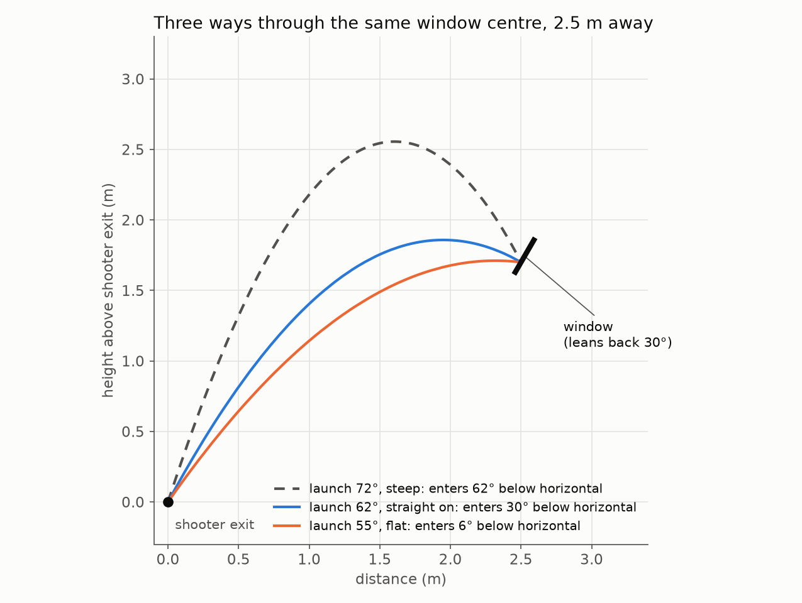
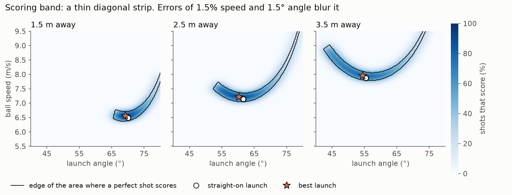
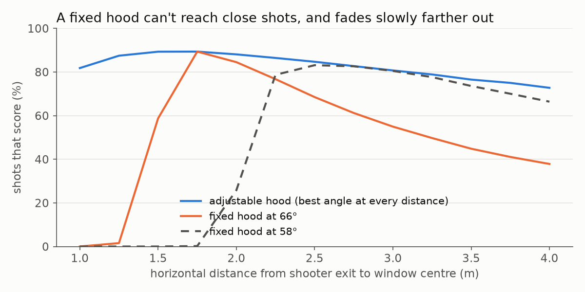

# Aiming the shot: launch angle and ball speed

**For:** the student designing the shooter hood and choosing shooting spots, and the coach working through it with them.
**Question:** what launch angle and ball speed get the most balls through the goal window, from each distance?
**Companion document:** [SHOOTER-PID.md](SHOOTER-PID.md), which holds the wheel speed steady. This document says what that speed should be and why steadiness matters so much.

## The short version

- **A straight-on entry is a very good starting rule.** The ball should come down through the window at about 30° below horizontal, square to the leaning window. From farther away, that takes a flatter launch and a faster ball: **about 70° and 6.5 m/s at 1.5 m, 58° and 7.5 m/s at 3 m**.
- **The best shot passes about 5 cm above the window's centre.** The triangle has more room above its centre than below it, so a slightly faster shot crossing in the middle of the open height scores more often. With realistic errors this adds about 10 percentage points to the hit rate (75% → 85% from 2.5 m). The launch angle hardly changes: within 1.5° of straight-on.
- **The scoring band is narrow in speed.** From 2 m, a shot at the right angle misses if its speed is off by more than about **±1.4–2.2%** (±50–80 RPM at the wheel). An angle error of about ±3–5° is allowed. **Steady ball speed matters more than anything else**, which is exactly what the PID work is for. At 3% speed scatter the hit rate falls to about 50–60%, and a fixed-power burst sags by up to 12%.
- **A fixed hood can't reach close shots, and fades slowly farther out.** Each fixed angle has a closest distance it can score from, about 3.4 m ÷ tan(angle). It works best just beyond that and covers about 1 m of distance well (58°: 74–83% from 2.5–3.5 m). To score from both close and far spots, use an **adjustable hood** (a servo).
- **Expect about 3300–4400 wheel RPM if the ball doesn't slip, or about 4100–5500 RPM at 80% grip.** Long shots may need more than 5000 RPM, where SHOOTER-PID.md shows rapid fire suffers. Measure the grip (Section 7) before deciding.
- Air drag adds about 3–7% to the speed needed but changes the best angle by only about 1°. Backspin and the triangle's orientation barely change the answer.

Everything here comes from a simulation using the dimensions below and an estimated ball. **Test shooting decides the final numbers.** The value of this study is knowing which angle to build, which numbers to look for, and how small the error margin is.

---

## 1. The problem

| Quantity | Value | Source |
|---|---|---|
| Window shape | Triangle, 53 cm wide at the base, 30 cm tall measured along the window | Given |
| Window tilt | Top leans back, away from the shooter, 30° from vertical | Given |
| Window centre | 1.7 m above where the ball leaves the shooter | Given; "centre" taken as the triangle's centroid, 10 cm above its base |
| Ball | 2.8 in (71 mm) whiffle ball, 35 g | Size given, weight estimated (same as SHOOTER-PID.md) |
| Air drag | Drag coefficient 0.5 | Estimate: the holes make it draggier than a smooth ball |
| Triangle orientation | Point at the top | Assumed. Section 8 shows the point-down case gives almost the same answer |
| Distance | 1–4 m, measured on the floor from the shooter exit to the window centre | Range studied |

The ball must enter **on the way down**. The study counts a shot as scoring only if **the whole ball** passes through **without touching the frame**. That's strict, because a ball that clips the edge may still drop in, so real hit rates may be a little higher.



## 2. Why "straight on" is the right starting point

Look at a door from straight in front and it looks its full width. Walk to the side and it looks narrower. The window does the same: a ball arriving at an angle to the window "sees" a shorter triangle, while the ball itself stays the same size.

The ball's size matters a lot here. Its **centre** must stay at least one ball radius (3.6 cm) inside every edge. That leaves a smaller triangle for the centre to pass through: **392 cm², only 49% of the window's 795 cm²**. Every degree the ball arrives off-square shrinks that further.

So the starting rule is that the ball should come in **square to the window**. The window leans back 30° from vertical, so square to it means **travelling down at 30° below horizontal**.

### The straight-on launch, with a little algebra

Without air, the horizontal speed stays the same for the whole flight. Requiring the ball to reach the window centre (distance `D`, height `h` = 1.7 m) while moving down at 30° gives one neat result for the flight time `t`:

```
g t² / 2 = h + D · tan(30°)
```

Then the horizontal speed is `D / t`, the starting vertical speed is `g t − D tan(30°) / t`, and the launch speed and angle follow from those two. A student can check the table below with a calculator, and the simulation then adds air drag:

| Distance (m) | No air: speed (m/s) | No air: angle | With drag: speed (m/s) | With drag: angle | Peak above window | Flight time |
|---|---|---|---|---|---|---|
| 1.0 | 6.02 | 75.9° | 6.22 | 75.5° | 4 cm | 0.68 s |
| 1.5 | 6.25 | 70.6° | 6.49 | 70.0° | 7 cm | 0.72 s |
| 2.0 | 6.52 | 66.3° | 6.80 | 65.5° | 11 cm | 0.75 s |
| 2.5 | 6.81 | 62.7° | 7.14 | 61.6° | 16 cm | 0.79 s |
| 3.0 | 7.11 | 59.7° | 7.50 | 58.3° | 21 cm | 0.82 s |
| 3.5 | 7.41 | 57.2° | 7.88 | 55.5° | 26 cm | 0.85 s |
| 4.0 | 7.71 | 55.0° | 8.26 | 53.0° | 31 cm | 0.88 s |

Things to notice:

- **The ball only peaks 4–31 cm above the window.** A 30° descent is gentle, so the ball comes down just past the top of its arc.
- **Distance changes the angle much more than the speed.** Going from 1 m to 4 m needs about 23° less launch angle but only about a third more speed.
- **Closer than about 1 m is suspicious.** The window's plane, extended downward, reaches shooter height about 1 m in front of the window centre. Closer than that, the ball would have to rise up behind that line, close under the window's front edge, before coming down through it. Check this against the real goal before planning a close-in shot.

## 3. Real shots are not perfect

The shooter never launches two balls exactly alike. Wheel speed varies a little, balls differ in grip and squish, and the ball leaves the hood a little higher or lower each time. So the useful question is **which aim scores most often when every shot is slightly off**.

The simulation flew about 160,000 balls for each distance, one for every combination of launch angle (30–80°) and speed (4–12 m/s), and recorded which ones scored. Then it blurred that map with typical random errors and read off the fraction that score:

- speed scatter of 1.5% (one standard deviation), e.g. ±60 RPM at 4000 RPM
- launch angle scatter of 1.5°

These are estimates for a well-built shooter running the PID code. Measure them on the robot (Section 9).



**The scoring area is a thin diagonal strip.** Steeper launches need a bit less speed and flatter ones need more, but at any one angle the speed has very little room. Speed is the narrow direction.

| Distance | Straight on: angle / speed | Hit rate | Speed room | Angle room | Side room | Best: angle / speed | Hit rate | Speed room | Angle room | Side room | Enters at | Wheel RPM, no slip |
|---|---|---|---|---|---|---|---|---|---|---|---|---|
| 1.0 m | 75.5° / 6.22 | 70% | ±1.7% | ±1.8° | 13 cm | 75.8° / 6.32 | 82% | ±2.4% | ±2.4° | 8 cm | 33° | 3350 |
| 1.5 m | 70.0° / 6.49 | 79% | ±1.5% | ±2.3° | 13 cm | 69.3° / 6.56 | 89% | ±2.2% | ±3.6° | 8 cm | 24° | 3480 |
| 2.0 m | 65.5° / 6.80 | 77% | ±1.4% | ±2.9° | 13 cm | 64.0° / 6.87 | 88% | ±2.2% | ±4.8° | 9 cm | 22° | 3650 |
| 2.5 m | 61.6° / 7.14 | 75% | ±1.3% | ±3.7° | 13 cm | 60.3° / 7.22 | 85% | ±2.0% | ±4.7° | 9 cm | 24° | 3830 |
| 3.0 m | 58.3° / 7.50 | 72% | ±1.2% | ±3.9° | 13 cm | 57.0° / 7.59 | 81% | ±1.8% | ±4.3° | 9 cm | 25° | 4030 |
| 3.5 m | 55.5° / 7.88 | 71% | ±1.1% | ±3.3° | 13 cm | 54.5° / 7.96 | 77% | ±1.8% | ±3.9° | 9 cm | 27° | 4220 |
| 4.0 m | 53.0° / 8.26 | 67% | ±1.0% | ±2.7° | 13 cm | 53.3° / 8.32 | 73% | ±1.6% | ±4.1° | 9 cm | 30° | 4410 |

*Speeds in m/s. "Room" is how far one error can go, with the other errors at zero, before the ball touches the frame. "Side room" is how far left or right the ball can pass. "Best" is the launch with the highest hit rate. The wheel RPM column assumes no slip; see Section 7.*

What the table says:

1. **The best launch angle is within 1.5° of straight-on.** Building the hood for a straight-on entry is the right design rule.
2. **The best speed is about 1% faster than straight-on.** A straight-on shot through the centre crosses only 6.4 cm above the lowest usable point, but 14.6 cm below the highest one (the triangle's point is far above its centre). The best shot crosses about **5 cm above the centre**, in the middle of the open height. It enters at 22–33° instead of exactly 30°, which costs little.
3. **Sideways room is the price.** The triangle narrows toward its point, so the higher crossing leaves 8–9 cm of side room instead of 13 cm. From 2.5 m, 9 cm means the robot's heading can be off by about ±2° (13 cm allows about ±3°). The hit rates above cover only up-and-down errors. If the robot's aim drifts sideways a lot, stay closer to the centre.
4. **Farther is harder.** The best hit rate falls from about 89% at 1.5 m to 73% at 4 m, because the same percentage speed error moves the ball more at the window.

## 4. What matters most: steady speed

The hit rate depends heavily on which error is bigger. Best launch angle / entry angle / hit rate:

| Errors (one standard deviation) | 1.5 m | 2.5 m | 3.5 m |
|---|---|---|---|
| Speed 0.5%, angle 1.5° (very steady speed) | 69.8° / 27° / **99%** | 61.3° / 28° / **100%** | 56.8° / 33° / **100%** |
| Speed 1.5%, angle 1.5° (our estimate) | 69.3° / 24° / 89% | 60.3° / 24° / 85% | 54.5° / 27° / 77% |
| Speed 3%, angle 1.5° (e.g. a loose ready-to-shoot tolerance) | 69.3° / 24° / **60%** | 56.8° / 12° / **55%** | 47.0° / 8° / **50%** |
| Speed 1.5%, angle 0.5° (very steady angle) | 67.5° / 11° / 92% | 54.8° / 5° / 90% | 45.0° / 4° / 87% |

- **Cutting speed scatter from 1.5% to 0.5% takes the hit rate to nearly 100%.** Cutting angle scatter by the same factor gains only 3–10 points.
- With a fixed motor power, SHOOTER-PID.md found the wheel about 570 RPM (12%) slow by the fourth ball, which is far outside the scoring band. With the PID the wheel is back within about 20 RPM (0.5%) when each ball arrives. **Holding the wheel speed is the biggest single improvement to accuracy.**
- When speed is noisy, the best launch gets flatter. When the angle is steady, a flat shot that skims in tolerates more speed error. Since our speed should be steady, **stay close to straight-on.**
- What's left of the speed scatter comes from the ball: differences in grip, squish and spin. Keep the balls in good shape, and fix the hood compression so it's the same for every ball.

**A setting to revisit after tuning:** `ShooterConfig.atSpeedToleranceRpm` is 100 RPM, which is about 2.5% at 4000 RPM, wider than the scoring band. Once the PID holds the speed well on the robot, try 50 RPM, so "ready to shoot" means the wheel is close enough to score.

## 5. Fixed hood or adjustable hood?

The hit rates in Section 3 assume the angle can change for each distance. With a **fixed hood**, only the wheel speed changes, so the ball reaches the window at whatever entry angle that gives.



**Each fixed angle has a hard limit on the near side.** Closer than that, the ball reaches the window before the top of its arc, so it can't come down through it. Without air the limit is about:

```
closest distance ≈ 2 × 1.7 m ÷ tan(hood angle)  =  3.4 m ÷ tan(hood angle)
```

Just past that limit is the fixed hood's best distance. Farther out, the ball arrives steeper and steeper, the window looks smaller, and the hit rate fades slowly.

Hit rate with a fixed hood (speed set to the best value for each distance):

| Hood angle | 1.0 m | 1.5 m | 2.0 m | 2.5 m | 3.0 m | 3.5 m | 4.0 m |
|---|---|---|---|---|---|---|---|
| 72° | 21% | 77% | 52% | 38% | 30% | 24% | 21% |
| 66° | can't | 59% | 84% | 68% | 55% | 45% | 38% |
| 62° | can't | can't | 86% | 83% | 73% | 62% | 53% |
| 58° | can't | can't | 26% | 83% | 80% | 74% | 66% |
| 55° | can't | can't | can't | 75% | 80% | 76% | 72% |
| *Adjustable* | *82%* | *89%* | *88%* | *85%* | *81%* | *77%* | *73%* |

*"can't" means under 5%. The 72° hood does best at 1.25 m (87%), which isn't in the table.*

Speed table for a fixed 66.3° hood, the best single angle if shots from 1.5 m to 3 m are needed:

| Distance (m) | 1.50 | 1.75 | 2.00 | 2.25 | 2.50 | 2.75 | 3.00 |
|---|---|---|---|---|---|---|---|
| Ball speed (m/s) | 6.56 | 6.71 | 6.88 | 7.10 | 7.33 | 7.57 | 7.82 |
| Hit rate | 59% | 89% | 85% | 77% | 68% | 61% | 55% |
| Enters at (below horizontal) | 4° | 21° | 33° | 40° | 46° | 49° | 52° |
| Wheel RPM, no slip | 3480 | 3560 | 3650 | 3770 | 3890 | 4020 | 4150 |
| Wheel RPM, grip 0.8 | 4350 | 4450 | 4560 | 4710 | 4860 | 5020 | 5190 |

What this means for the design:

- **The closest shooting spot sets a fixed hood's angle.** Choose the angle whose limit is a little closer than that spot. Right at the limit, the hit rate is poor (66° at 1.5 m: 59%).
- **Shots from the near spot to about 1 m beyond it work with a fixed hood.** For example, 58° gives 74–83% from 2.5 to 3.5 m.
- **A fixed hood can't cover both close and far.** No single angle scores better than 55% across 1.5–3 m.
- **Adjustable hood:** a servo moving the hood across about 53–76° gives the best hit rate at every distance from 1 to 4 m. The extra cost is a servo, a stiff linkage that holds its angle when the ball pushes on it, and an angle table next to the RPM table.

**Recommendation:** choose the shooting spots first. If they lie within about 1 m of each other, use a fixed hood set for the nearest one. If the strategy needs both close and far shots, an adjustable hood is worth it.

## 6. Turning this into robot settings

The robot needs a table: **distance → wheel RPM** (and **distance → hood angle**, if adjustable). The robot already knows its position from odometry, so the distance to the goal can be calculated in code, and the table can be interpolated between test points. Build the table from test shooting, using the simulation to choose where to start.

## 7. From ball speed to wheel RPM

The ball rolls between the Rhino wheel and the hood, so its centre moves at **half the wheel's surface speed**, minus some slip:

```
wheel RPM = 530 × ball speed (m/s) ÷ grip
```

`grip` is 1.0 for no slip. Real shooters usually lose some speed to slip and to the ball squashing, so 0.7–0.9 is a typical range.

| Ball speed | 6.5 m/s | 7.0 m/s | 7.5 m/s | 8.0 m/s | 8.5 m/s |
|---|---|---|---|---|---|
| No slip (grip 1.0) | 3450 | 3710 | 3980 | 4240 | 4510 |
| Grip 0.8 | 4310 | 4640 | 4970 | 5300 | 5640 |

This connects to the PID study. **Above about 5000 RPM, the motor has too little spare torque to recover between quick shots.** If our grip is 0.8, shots from about 3 m and farther land there. To avoid that, raise the grip (more hood compression or a grippier wheel surface), shoot from closer, or add the second motor described in SHOOTER-PID.md Section 7.

**Measuring the grip:** fire balls horizontally from a known height (about 1 m) and measure how far they land:

```
ball speed = landing distance ÷ √(2 × height ÷ 9.81)
grip = 530 × ball speed ÷ wheel RPM
```

Air drag makes this read about 3–4% low, so add 3–4% to the ball speed. Read the wheel RPM from Panels just before the ball enters. A phone filming at 240 fps against a measuring tape also works.

## 8. How much can we trust these numbers?

The simulation depends on estimates. Each row changes one of them (best angle / speed / hit rate):

| Case | 1.5 m | 2.5 m | 3.5 m |
|---|---|---|---|
| Our estimate (35 g, drag 0.5, no spin) | 69.3° / 6.56 / 89% | 60.3° / 7.22 / 85% | 54.5° / 7.96 / 77% |
| No air at all | 69.8° / 6.31 / 87% | 60.5° / 6.88 / 81% | 55.8° / 7.48 / 72% |
| Less drag (50 g ball, or drag 0.35) | 69.3° / 6.48 / 89% | 60.5° / 7.11 / 84% | 55.0° / 7.81 / 75% |
| More drag (25 g ball, or drag 0.7) | 69.0° / 6.66 / 90% | 59.8° / 7.37 / 86% | 54.8° / 8.15 / 78% |
| Backspin lift, coefficient 0.1 | 68.8° / 6.55 / 89% | 59.5° / 7.21 / 85% | 54.3° / 7.93 / 77% |
| Backspin lift, coefficient 0.2 | 68.5° / 6.54 / 89% | 59.3° / 7.19 / 84% | 53.8° / 7.90 / 76% |
| Triangle point down | 69.0° / 6.42 / 91% | 59.8° / 7.10 / 86% | 54.3° / 7.85 / 78% |

*Speeds in m/s.*

- **The best angle is solid:** every case lands within about 1.5° of our estimate. The hood design does not depend on the guesses.
- **The speed is not:** from 3.5 m, the cases range from 7.48 to 8.15 m/s, about 9% apart. Treat the speeds as a starting point and **find the real RPM by test shooting**.
- Only the drag-to-weight ratio matters for drag, which is why a heavier ball and a lower drag coefficient give the same row. **Weigh a ball.**
- With the triangle's point at the bottom, the best shot crosses a little below the centre instead of above it. The speeds shift by about 1%, and the conclusions don't change.

Not modeled:

- Whiffle balls can swerve ("knuckle"), depending on where the holes face. This adds random scatter that no setting can remove. Test-shoot with real balls.
- Balls that clip the frame but still go in. These make real hit rates higher.
- Anything behind the window, e.g. a back wall the ball might bounce out from. A straight-on entry is gentlest on this too.
- Sideways errors in the hit rate (they appear only in the "side room" column).

## 9. Field test plan

Do these with the PID working, so wheel speed isn't a variable.

| Step | What to do | What it tells you |
|---|---|---|
| **1. Grip** | Measure ball speed against wheel RPM (Section 7) at 3500 and 4500 RPM | Converts this document's ball speeds into RPM |
| **2. Speed band** | From one distance with the planned hood angle, shoot 5 balls at each RPM in steps of 50 RPM. Note the lowest and highest RPM where almost all of them score | The real band. **Set the RPM in the middle of it**, not at the first value that scores |
| **3. Scatter** | Shoot 20 balls at the middle RPM. Count the hits, and note whether misses are high/low or left/right | High/low misses mean speed or angle scatter, left/right misses mean aiming |
| **4. Repeat** | Do steps 2–3 at each planned shooting distance | The distance → RPM table |
| **5. Burst** | Fire four-ball bursts at the middle RPM | Shows whether balls 3 and 4 fall short, i.e. whether the wheel recovers in time |

If the band from step 2 is much narrower than about ±2% of the RPM, ball-to-ball differences are large: check ball condition and hood compression. If balls 3–4 fall short only in bursts, the issue is wheel recovery: see SHOOTER-PID.md Sections 6–7.

## 10. Files

| File | Purpose |
|---|---|
| `docs/shooter_sim/TrajectorySim.java` | The simulation behind this document. Plain Java; see its header for how to run it (a few minutes) |
| `docs/shooter_img/traj_*.png` | The figures |

To redo the study with real measurements, change the numbers at the top of `TrajectorySim.java` (window size, height, lean, ball weight) or the error sizes in `TYPICAL`, and run it again.
